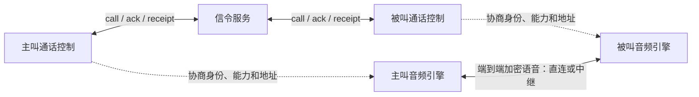
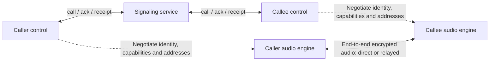

# WhatsApp 语音通话 · WhatsApp Voice Calls

[中文](#zh) · [English](#en) · [Telegram: @ttjjda](https://t.me/ttjjda)

## 中文

本仓库介绍 WhatsApp 一对一语音的 XMPP 信令：呼叫时序、节点字段、设备扇出、通话密钥封装、地址协商及异常收尾，配有节点树示例和伪代码。实时语音与媒体概念见[公开 Wiki 的语音通话目录](https://github.com/WhatsappWiki/whatsapp-technical-wiki/tree/main/calls#zh)。

### 连续阅读

| 顺序 | 文档 | 主要内容 |
| --- | --- | --- |
| 1 | [通信架构与标识](docs/01-architecture.md#zh) | 协议树、Noise 连接、JID 与两层 ID |
| 2 | [一次呼叫的信令过程](docs/02-call-lifecycle.md#zh) | offer、确认、预接受、接听、拒接与结束 |
| 3 | [设备路由与通话密钥封装](docs/04-device-routing-and-keys.md#zh) | 按设备加密、protobuf、填充与接听设备选择 |
| 4 | [地址协商与中继信息](docs/05-transport-negotiation.md#zh) | transport、relay、测量与配置的协作 |
| 5 | [状态、乱序与异常收尾](docs/06-state-and-recovery.md#zh) | Accept 缓存、迟到消息、重试与资源释放 |
| 6 | [XMPP 交互伪代码](docs/07-signaling-pseudocode.md#zh) | 将收发、状态约束与异常收尾串起来 |

### 按需查阅

| 文档 | 内容 |
| --- | --- |
| [完整字段参考](docs/03-signaling-fields.md#zh) | 16 类共享结构、14 类消息与确认内容，保留全部 152 条字段记录 |
| [原生状态与 Java 映射](docs/06-state-and-recovery.md#zh-native-state-map) | 原生编号、枚举映射与转移限制 |
| [术语与常见问题](docs/08-glossary-and-faq.md#zh) | 术语速查、常见疑问及对应章节 |
| [语音通话目录（公开 Wiki）](https://github.com/WhatsappWiki/whatsapp-technical-wiki/tree/main/calls#zh) | 一对一语音、群组语音与通话安全架构 |

### 通话的两条路径

信令推进通话状态，媒体路径连续传送声音。确认、接听和媒体可用性的区别统一见[流程中的确认语义](docs/02-call-lifecycle.md#zh-confirmations)。

### 阅读约定

- XML 代码块展示节点树；实际信令使用二进制协议树编码。
- 大写标识是占位符；ENDPOINT_BYTES、SIGNAL_CIPHERTEXT 等代表原始字节。
- `@name` 表示属性，`$body` 表示内容，`[]` 表示重复节点；字段的方向、必需性与条件见[字段表记法](docs/03-signaling-fields.md#zh-field-notation)。
- 主线为一对一语音；群组、视频、机器人和等候室只解释相关条件字段。
- 伪代码保留信令和状态顺序；身份、Signal 会话、网络与媒体分别由相应组件提供。

[English](#en)

## English

This repository explains XMPP signaling for WhatsApp one-to-one voice calls: call sequences, node fields, device fanout, call-key envelopes, transport negotiation and failure cleanup, with node-tree examples and pseudocode. For real-time audio and media concepts, see the [public Wiki voice-calling directory](https://github.com/WhatsappWiki/whatsapp-technical-wiki/tree/main/calls#en).

### Read in sequence

| Order | Document | Main topics |
| --- | --- | --- |
| 1 | [Architecture and identifiers](docs/01-architecture.md#en) | Protocol trees, Noise connections, JIDs and the two ID scopes |
| 2 | [Call signaling lifecycle](docs/02-call-lifecycle.md#en) | Offer, acknowledgments, preaccept, acceptance, rejection and termination |
| 3 | [Device routing and call-key envelopes](docs/04-device-routing-and-keys.md#en) | Per-device encryption, protobuf, padding and answering-device selection |
| 4 | [Transport negotiation and relay information](docs/05-transport-negotiation.md#en) | Cooperation between transport, relay, measurements and configuration |
| 5 | [State, reordering and cleanup](docs/06-state-and-recovery.md#en) | Cached Accept, late messages, retries and resource release |
| 6 | [XMPP interaction pseudocode](docs/07-signaling-pseudocode.md#en) | Connecting message handling, state constraints and failure cleanup |

### Reference material

| Document | Contents |
| --- | --- |
| [Complete field reference](docs/03-signaling-fields.md#en) | All 152 field records across 16 shared structures and 14 message or acknowledgment families |
| [Native state and Java mapping](docs/06-state-and-recovery.md#en-native-state-map) | Native values, enum mapping and transition restrictions |
| [Glossary and FAQ](docs/08-glossary-and-faq.md#en) | Terminology, common questions and links to the relevant sections |
| [Voice-calling directory in the public Wiki](https://github.com/WhatsappWiki/whatsapp-technical-wiki/tree/main/calls#en) | One-to-one voice, group voice and call security architecture |

### The two paths of a call

Signaling advances call state; the media path carries continuous audio. The distinction between acknowledgment, answering and media availability is explained in [acknowledgment semantics](docs/02-call-lifecycle.md#en-confirmations).

### Reading conventions

- XML blocks display node trees; actual signaling uses binary protocol-tree encoding.
- Uppercase names are placeholders. ENDPOINT_BYTES and SIGNAL_CIPHERTEXT represent raw bytes.
- `@name` denotes an attribute, `$body` the content and `[]` repeated nodes. See [field-table notation](docs/03-signaling-fields.md#en-field-notation) for direction, requiredness and conditions.
- The main flow is one-to-one voice. Group, video, bot and waiting-room content appears only where needed to explain conditional fields.
- Pseudocode preserves signaling and state order; identity, Signal sessions, networking and media are supplied by their respective components.

[中文](#zh)
