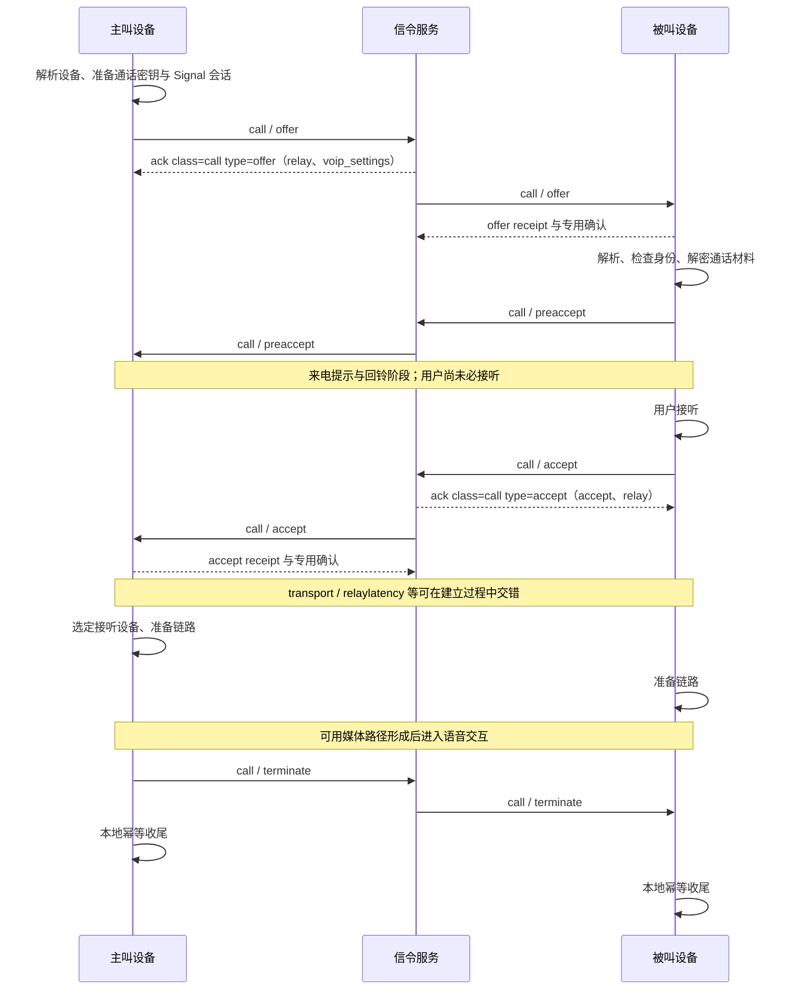

# 一次呼叫的信令过程 · Call Signaling Lifecycle

[首页](../README.md#zh) · [中文](#zh) · [English](#en) · [Telegram: @ttjjda](https://t.me/ttjjda)

<a id="zh"></a>

## 中文

### 主线时序

下图是一条普通的一对一语音流程。ACK、receipt、预接听与候选更新可以交错到达，图中的排列用于解释职责，不要求所有网络事件严格按图排序。



<a id="zh-confirmations"></a>

### 确认、接听与媒体状态

| 事件 | 表达的进度 | 关联方式 |
| --- | --- | --- |
| call ACK | 相应信令的处理结果，可带配置或错误 | 外层 id、class=call、type=业务标签；再核对返回的 call-id |
| receipt | 相应信令已进入接收侧处理路径 | 原 stanza ID 加 offer／accept 等业务子节点 |
| preaccept | 设备预接受并交换能力 | 当前 call-id 与来源设备 |
| accept | 接受通话 | 当前通话与实际接听设备 |
| 活跃／媒体指标 | 引擎活跃、链路可用、有效收包、解码或播放 | 各指标分别记录 |

普通非静默 offer 可以在完整解析和密钥解密前安排 receipt 与专用 ACK，因此 receipt 不证明解密完成。receipt 自身走 class=receipt 的确认路径，与 call ACK 分开。preaccept 尚不代表用户接听，accept 也仍需后续链路准备。

### 1. 发起前准备

通话控制器先检查号码和身份是否有效、网络是否可用、是否已有通话、联系人限制与麦克风权限。系统电话通话、音频焦点和平台通话框架也会影响是否能启动。

目标身份解析得到用户与设备集合，再准备 PreKey 和加密材料，详见[待发送 offer](04-device-routing-and-keys.md#zh-pending-offer)。

本地“启动成功”只表示任务已受理或引擎已启动，不等于 offer 已到服务端、对端已收到或用户已接听。

### 2. 主叫发送 offer

```xml
<call to="CALLEE_USER_JID" id="OFFER_STANZA_ID">
  <offer call-id="CALL_ID" call-creator="CALLER_DEVICE_JID">
    <audio enc="opus" rate="16000" />
    <audio enc="opus" rate="48000" />
    <encopt keygen="2" />
    <capability ver="1">CAPABILITY_BYTES</capability>
    <net medium="NETWORK_MEDIUM" />
    <enc v="2" type="pkmsg">SIGNAL_CIPHERTEXT</enc>
  </offer>
</call>
```

offer 可列出多个采样率；可选值和编码标签的解释见[音频字段](03-signaling-fields.md#zh-shared-audio)。

示例使用单个 enc；多设备结构见[destination 扇出](04-device-routing-and-keys.md#zh-device-fanout)。各分支按字段参考补充条件节点。

<a id="zh-offer-ack"></a>

### 3. 处理 offer ACK

```xml
<ack from="ACK_PEER_JID" id="OFFER_STANZA_ID" class="call" type="offer">
  <relay call-id="CALL_ID">
    <token>RELAY_TOKEN_BYTES</token>
    <te relay_id="0" token_id="0">RELAY_ENDPOINT_BYTES</te>
  </relay>
  <voip_settings uncompressed="1">VOIP_SETTINGS_JSON_BYTES</voip_settings>
</ack>
```

成功的一对一分支要求 relay 和至少一份 voip_settings。普通成功分支从 relay 取得 call-id；群组与错误分支的选择顺序见[offer ACK 字段](03-signaling-fields.md#zh-message-offer_ack)。

错误处理保留外层状态与各目标错误。字段表中的 offer_ack 是内容分类，线上外层仍为 ack。

### 4. 被叫收到 offer

被叫读取来源、外层 id、业务标签和 call-id，再送入通话队列。确认按[前述语义](#zh-confirmations)安排：

```xml
<receipt to="CALLER_DEVICE_JID" id="OFFER_STANZA_ID">
  <offer call-id="CALL_ID" call-creator="CALLER_DEVICE_JID" />
</receipt>
```

接收侧继续检查注册材料、设备身份、重复密文与重试状态，选择本机 enc，通过 Signal 会话解密后交给引擎。封装与解密边界见[通话密钥](04-device-routing-and-keys.md#zh-signal-envelope)。

推送预览和正式 offer 分别处理。后台推送可以提示存在来电或结束事件，但预览不代替正式节点的身份校验、解析和解密。通知权限、后台状态、系统通话框架和来电隐私策略会影响实际提示方式。

### 5. preaccept 推进到来电阶段

```xml
<call to="CALLER_DEVICE_JID" id="PREACCEPT_STANZA_ID">
  <preaccept call-id="CALL_ID" call-creator="CALLER_DEVICE_JID">
    <audio enc="opus" rate="16000" />
    <encopt keygen="2" />
    <capability ver="1">CAPABILITY_BYTES</capability>
  </preaccept>
</call>
```

preaccept 更新设备能力、临时活动设备信息与回铃状态。多个设备可以分别处理来电；必需字段见[preaccept 表](03-signaling-fields.md#zh-message-preaccept)，最终设备选择见[设备路由](04-device-routing-and-keys.md#zh-device-selection)。

### 6. 用户接听并发送 accept

```xml
<call to="CALLER_DEVICE_JID" id="ACCEPT_STANZA_ID">
  <accept call-id="CALL_ID" call-creator="CALLER_DEVICE_JID">
    <audio enc="opus" rate="16000" />
    <encopt keygen="2" />
    <capability ver="1">CAPABILITY_BYTES</capability>
    <net medium="NETWORK_MEDIUM" />
  </accept>
</call>
```

用户接听后进入 accept 流程，消息可带新 enc、证书指纹、HMAC、中继或选中端点。audio 与条件节点规则见[accept 表](03-signaling-fields.md#zh-message-accept)；新 enc 按对应分支解密和应用。

```xml
<ack from="ACK_PEER_JID" id="ACCEPT_STANZA_ID" class="call" type="accept">
  <accept call-id="CALL_ID" />
  <relay>
    <token>RELAY_TOKEN_BYTES</token>
    <te relay_id="0" token_id="0">RELAY_ENDPOINT_BYTES</te>
  </relay>
</ack>
```

成功且非等候室的 accept ACK 要求 `accept@call-id` 和 relay；`voip_settings` 可选。没有 accept 子节点时可以按忽略处理，而不是自动进入接通。错误分支要求 error 节点提供 `call-id` 与 `jid`。

主叫接收 accept 时还可能发送 accept receipt。receipt 的业务子节点用 `<accept>`，外层仍引用原 accept 信令的 stanza ID。

### 7. 地址、配置与媒体准备

双方通过已有 offer、accept 与后续 transport 更新交换网络信息，处理服务端提供的 relay 和配置。relaylatency 用于测量结果交互；ready 和 relay_info_update 是另外的控制事件。

这些消息可在接听前后交错；引擎根据接听、设备选择和网络准备共同推进。详见[地址协商](05-transport-negotiation.md#zh)。

### 8. 拒接、取消与挂断

被叫拒绝待接听的来电使用 reject：

```xml
<call to="CALLER_DEVICE_JID" id="REJECT_STANZA_ID">
  <reject call-id="CALL_ID" call-creator="CALLER_DEVICE_JID" reason="busy" count="0" />
</call>
```

`busy` 是原因文本示例。解密问题可走 `reason="enc"` 分支，并携带恰好 4 字节的 registration 材料；这与用户拒接分别处理。

接听前取消和接通后挂断都可进入 terminate 流程，状态与原因决定最终结果：

```xml
<call to="PEER_JID" id="TERMINATE_STANZA_ID">
  <terminate call-id="CALL_ID" call-creator="CALLER_DEVICE_JID" reason="END_REASON" />
</call>
```

结束时停止待确认跟踪、协调未完成的加密任务与 pending offer，再发送必要的结束信令和释放资源。某些已结束通话仍会发送移除密钥的 pending offer，以保留通话关联与结束信息，不能统一简化为“取消后丢掉一切待发送节点”。

结束的幂等与异常收尾见[状态篇](06-state-and-recovery.md#zh-ending)；时长字段规则见[terminate 表](03-signaling-fields.md#zh-message-terminate)。

[下一篇：设备路由与通话密钥封装](04-device-routing-and-keys.md#zh) · [完整字段参考](03-signaling-fields.md#zh)

[English](#en)

<a id="en"></a>

## English

[Home](../README.md#en) · [中文](#zh)

### Main sequence

The diagram shows a normal one-to-one voice call. ACKs, receipts, preaccept and candidate updates may arrive interleaved; the order explains their roles rather than imposing a strict network sequence.

```mermaid
sequenceDiagram
    participant A as Caller device
    participant S as Signaling service
    participant B as Callee device
    A->>A: Resolve devices, prepare call keys and Signal sessions
    A->>S: call / offer
    S-->>A: ack class=call type=offer (relay, voip_settings)
    S->>B: call / offer
    B-->>S: Offer receipt and dedicated acknowledgment
    B->>B: Parse, check identity and decrypt call material
    B->>S: call / preaccept
    S->>A: call / preaccept
    Note over A,B: Incoming notification and ringback; the user may not have answered
    B->>B: User answers
    B->>S: call / accept
    S-->>B: ack class=call type=accept (accept, relay)
    S->>A: call / accept
    A-->>S: Accept receipt and dedicated acknowledgment
    Note over A,B: transport / relaylatency may interleave during setup
    A->>A: Select answering device and prepare transport
    B->>B: Prepare transport
    Note over A,B: Voice interaction begins after a usable media path is established
    A->>S: call / terminate
    S->>B: call / terminate
    A->>A: Idempotent local cleanup
    B->>B: Idempotent local cleanup
```

<a id="en-confirmations"></a>

### Acknowledgment, answering and media state

| Event | Progress represented | Correlation |
| --- | --- | --- |
| Call ACK | Processing result for the signal, possibly including configuration or errors | Outer id, class=call and type=business tag; also check the returned call-id |
| Receipt | The signal has entered the receiving handler | Original stanza ID plus an offer, accept or other business child |
| preaccept | Device preacceptance and capability exchange | Current call-id and source device |
| accept | Call acceptance | Current call and the actual answering device |
| Active/media indicators | Engine activity, path availability, valid reception, decoding or playout | Record each indicator separately |

A normal non-silent offer can schedule a receipt and a dedicated ACK before full parsing and key decryption, so a receipt does not prove decryption has completed. A receipt's own acknowledgment uses class=receipt, separately from call ACKs. preaccept does not yet represent the user's answer, and accept still requires transport preparation.

### 1. Preparation before initiation

The controller checks number and identity validity, connectivity, existing calls, contact restrictions and microphone permission. Cellular calls, audio focus and platform calling frameworks can also affect startup.

Target resolution produces user and device identities, followed by PreKey and encryption preparation. See [pending offers](04-device-routing-and-keys.md#en-pending-offer).

A local successful-start result means that the task was accepted or the engine started; it does not establish delivery to the service, receipt by the peer or user acceptance.

### 2. The caller sends offer

```xml
<call to="CALLEE_USER_JID" id="OFFER_STANZA_ID">
  <offer call-id="CALL_ID" call-creator="CALLER_DEVICE_JID">
    <audio enc="opus" rate="16000" />
    <audio enc="opus" rate="48000" />
    <encopt keygen="2" />
    <capability ver="1">CAPABILITY_BYTES</capability>
    <net medium="NETWORK_MEDIUM" />
    <enc v="2" type="pkmsg">SIGNAL_CIPHERTEXT</enc>
  </offer>
</call>
```

An offer can list multiple sample rates; see [audio fields](03-signaling-fields.md#en-shared-audio) for supported values and the meaning of the codec label.

The example uses a direct enc. For multiple devices, see [destination fanout](04-device-routing-and-keys.md#en-device-fanout). Add conditional nodes according to the applicable field-reference branch.

<a id="en-offer-ack"></a>

### 3. Processing the offer ACK

```xml
<ack from="ACK_PEER_JID" id="OFFER_STANZA_ID" class="call" type="offer">
  <relay call-id="CALL_ID">
    <token>RELAY_TOKEN_BYTES</token>
    <te relay_id="0" token_id="0">RELAY_ENDPOINT_BYTES</te>
  </relay>
  <voip_settings uncompressed="1">VOIP_SETTINGS_JSON_BYTES</voip_settings>
</ack>
```

The successful one-to-one branch requires relay and at least one voip_settings. A normal successful branch obtains call-id from relay; group and error precedence is described in [offer ACK fields](03-signaling-fields.md#en-message-offer_ack).

Error handling retains both the outer status and errors for individual targets. offer_ack is a field-reference category; the wire envelope remains ack.

### 4. The callee receives offer

The callee reads the source, outer id, business tag and call-id, then queues call processing. Acknowledgments follow the [semantics above](#en-confirmations):

```xml
<receipt to="CALLER_DEVICE_JID" id="OFFER_STANZA_ID">
  <offer call-id="CALL_ID" call-creator="CALLER_DEVICE_JID" />
</receipt>
```

The receiver checks registration material, device identity, duplicate ciphertext and retry state, selects its local enc, decrypts through the Signal session, and hands the result to the engine. See [call keys](04-device-routing-and-keys.md#en-signal-envelope) for envelope and decryption boundaries.

Push previews and formal offers are separate. A background push can indicate an incoming call or termination, but does not replace identity checking, parsing and decryption of the formal node. Notification permission, background state, platform calling frameworks and privacy policy influence presentation.

### 5. preaccept advances the incoming-call phase

```xml
<call to="CALLER_DEVICE_JID" id="PREACCEPT_STANZA_ID">
  <preaccept call-id="CALL_ID" call-creator="CALLER_DEVICE_JID">
    <audio enc="opus" rate="16000" />
    <encopt keygen="2" />
    <capability ver="1">CAPABILITY_BYTES</capability>
  </preaccept>
</call>
```

preaccept updates device capabilities, temporary active-device information and ringback. Multiple devices can handle the incoming call independently. Required fields are in the [preaccept table](03-signaling-fields.md#en-message-preaccept); final selection is described in [device routing](04-device-routing-and-keys.md#en-device-selection).

### 6. The user answers and sends accept

```xml
<call to="CALLER_DEVICE_JID" id="ACCEPT_STANZA_ID">
  <accept call-id="CALL_ID" call-creator="CALLER_DEVICE_JID">
    <audio enc="opus" rate="16000" />
    <encopt keygen="2" />
    <capability ver="1">CAPABILITY_BYTES</capability>
    <net medium="NETWORK_MEDIUM" />
  </accept>
</call>
```

The user answer initiates accept processing. The message may carry a new enc, certificate fingerprint, HMAC, relay or selected endpoint. See [accept fields](03-signaling-fields.md#en-message-accept) for audio and conditional-node rules. A new enc is decrypted and applied by its corresponding branch.

```xml
<ack from="ACK_PEER_JID" id="ACCEPT_STANZA_ID" class="call" type="accept">
  <accept call-id="CALL_ID" />
  <relay>
    <token>RELAY_TOKEN_BYTES</token>
    <te relay_id="0" token_id="0">RELAY_ENDPOINT_BYTES</te>
  </relay>
</ack>
```

A successful non-waiting-room accept ACK requires accept@call-id and relay; voip_settings is optional. A missing accept child may be ignored rather than activating the call. The error branch requires call-id and jid on the error node.

The caller may also send an accept receipt. Its business child is accept, while the outer ID references the original accept stanza.

### 7. Addresses, configuration and media preparation

The devices exchange network information through offer, accept and subsequent transport updates and process relay grants and configuration from the service. relaylatency handles measurements; ready and relay_info_update are separate control events.

These messages may interleave before or after answering. The engine advances using acceptance, device selection and network readiness together. See [transport negotiation](05-transport-negotiation.md#en).

### 8. Rejection, cancellation and hangup

The callee uses reject to decline a pending incoming call:

```xml
<call to="CALLER_DEVICE_JID" id="REJECT_STANZA_ID">
  <reject call-id="CALL_ID" call-creator="CALLER_DEVICE_JID" reason="busy" count="0" />
</call>
```

busy is an example reason. Decryption issues can use reason=enc and carry exactly four bytes of registration material; this is separate from a user rejection.

Both cancellation before answering and hangup after connection can enter termination processing. State and reason determine the final outcome:

```xml
<call to="PEER_JID" id="TERMINATE_STANZA_ID">
  <terminate call-id="CALL_ID" call-creator="CALLER_DEVICE_JID" reason="END_REASON" />
</call>
```

Ending stops acknowledgment tracking, coordinates unfinished encryption and pending offers, sends the necessary end signaling, and releases resources. Some ended calls still send a pending offer with its key removed to preserve call association and ending information. Pending nodes must therefore be handled by branch rather than all discarded on cancellation.

For idempotence and failure cleanup, see [state handling](06-state-and-recovery.md#en-ending). Duration rules are in the [terminate table](03-signaling-fields.md#en-message-terminate).

[Next: Device routing and call-key envelopes](04-device-routing-and-keys.md#en) · [Complete field reference](03-signaling-fields.md#en)

[中文](#zh)
