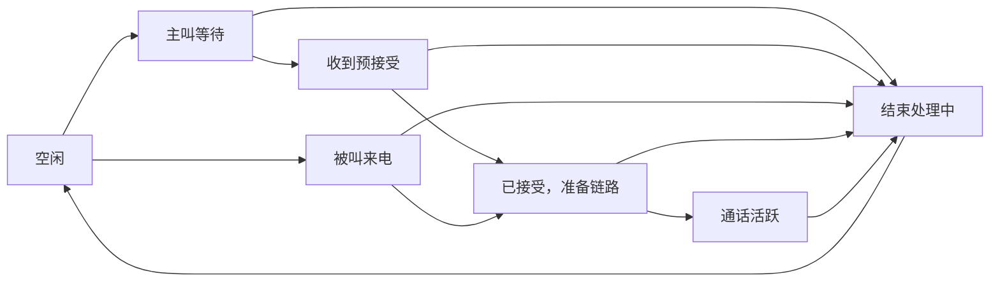
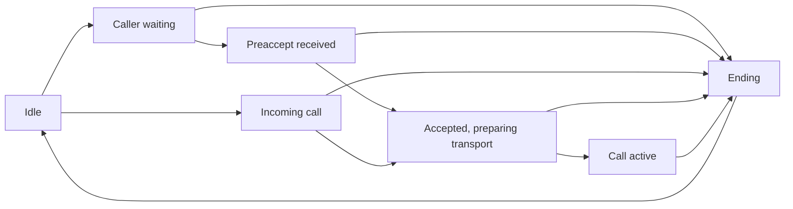

# 状态、乱序与异常收尾 · State, Reordering and Cleanup

[首页](../README.md#zh) · [中文](#zh) · [English](#en) · [Telegram: @ttjjda](https://t.me/ttjjda)

<a id="zh"></a>

## 中文

### 把三种状态分开

| 状态类别 | 回答的问题 | 例子 |
| --- | --- | --- |
| 通话控制状态 | 当前处于哪一业务阶段 | Calling、ReceivedCall、AcceptSent、CallActive |
| 信令事务状态 | 某条消息处理到哪里 | 待发送、待 ACK、已回执、失败或已停止跟踪 |
| 媒体与设备状态 | 是否有有效声音路径 | 路径可用、收到有效媒体、解码、播放、采集静音 |

确认与接听的解释见[流程篇](02-call-lifecycle.md#zh-confirmations)；原生编号另放在[附录](#zh-native-state-map)。

以下概念图仅展示主线阶段，不枚举引擎的全部允许转移：



<a id="zh-accept-ordering"></a>

### preaccept 与 accept 乱序

主叫处理 accept 时先确定对应接听设备。如果仍处于 Calling 且预接受阶段尚未完成，可以深复制一份 Accept 到待处理槽，等待 preaccept 推进后再取出重投。

```text
收到 accept
  → 核对设备并进行接听设备选择
  → 尚缺预接受上下文？
       是：深复制并缓存，暂不完成后续接受处理
       否：更新密钥、能力和链路，推进接受状态

收到有效 preaccept
  → 更新设备能力和阶段
  → 从槽中取出并清空已缓存 Accept
  → 重新投递到接受处理路径
```

缓存必须拥有独立数据，不能指向会随接收回调释放的临时节点。重投时也要再次核对 ending、通话 ID 和设备选择，避免迟到任务恢复已经结束的通话。

<a id="zh-device-filtering"></a>

### 接听设备确定后的过滤

主叫按[设备选择规则](04-device-routing-and-keys.md#zh-device-selection)确定活动设备后，后续信令继续核对用户、设备与活动设备，过滤其他设备的迟到消息。

被叫设备也可能通过自身账户其他设备的 accept/reject，或带 `accepted_elsewhere` 等原因的 terminate，得知该场来电已在别处处理。判定需要核对本地来电状态、自己账户身份、设备与原因条件，不能只匹配字符串 reason。

<a id="zh-late-offer"></a>

### terminate 可以先于 offer 到达

需要有独立于当前活动通话的短期结果记录，用来识别先结束后到达的 offer。相关处理使用按 call-id 索引的环形记录，保存结束结果、原因与事务进度；这里的结果缓存包含 30 个槽位。

当迟到 offer 对应已经在别处接听或筛选的通话时，处理路径可以更新相应记录而不再次响铃。其他已终止 offer 则进入过期或未接流程。不同非零处理结果发生冲突时，保留已经确定的结果，避免迟到事件覆盖它。

非 offer 消息先到而缺少 offer 或 offer ACK 上下文时，也可能暂存等待。缓存容量、过期策略和某个解密重试分支的阈值分别管理；不能把一个局部阈值写成整个通话协议的统一重试次数。

<a id="zh-retries"></a>

### 重复投递与重试

重复信令仍可能需要再次确认，但业务效果应保持幂等。例如重复 terminate 不应触发两次资源销毁，重复 offer 不应再次显示新的独立来电。

实现可以按来源设备、stanza ID 和消息类型保存处理记录，同时用 call-id 检查业务归属。消息正文、重试计数或 Signal 状态变化可能带来另一条有意义的重试，不能单纯用 call-id 丢弃所有后续 offer。

offer 和 accept 的待确认跟踪由配置与当前分支决定。没有 ACK、错误 ACK、对端解密失败与用户未接听分别处理；不应统一采用固定间隔无限重发。结束时还要撤销已无意义的重试任务。

### 本地计时不是全局协议常量

普通一对一 ReceivedCall 的本地来电计时默认为 45 秒；相应配置在 15..90 范围内时按秒换算为毫秒。PreAcceptReceived 的一条本地计时路径为 90 秒。

这些数值描述对应本地阶段。服务端、对端和网络路径可能各自有计时器；不能据此宣称所有设备、所有呼叫都在同一秒结束。

<a id="zh-ending"></a>

### 结束标志与资源释放

结束过程可以先置 ending 标志，停止计时并发出 callEnding，再清理异步任务、音频、参与者、传输、线程与内存池。原始状态清为 None 的时机还可受配置影响。

因此 UI 消失、通话状态归空和底层资源释放不是同一瞬间。接收入口要检查 ending 标志，即使主状态还未切换，也不能继续推进旧通话。

### 结束动作的并发边界

1. 用户动作带目标 call-id，排队后重新核对当前通话。
2. 首个结束事件创建共享完成句柄，置 ending 并使旧异步任务失效；重复结束返回同一句柄。
3. 停止计时与待确认跟踪，协调加密任务和 pending offer。
4. 按分支发送 reject／terminate；每次发送失败单独记录，继续收尾。
5. 分别停止并等待传输、媒体回调退出，再释放通话材料；任一环节失败都继续执行其他环节。
6. 保存结束结果与清理错误，按对象身份清除活动引用，完成共享句柄。

等待者取消等待时使用屏蔽取消的等待方式，收尾任务继续运行。具体实现见[异常收尾伪代码](07-signaling-pseudocode.md#zh-finish)。

本地音频初始化失败、中继绑定失败和 RTCP BYE 可以映射到服务层的本地结束原因。服务层数字原因与 wire 上的 reason 文本不是同一张表，不能直接互换。

[下一篇：XMPP 交互伪代码](07-signaling-pseudocode.md#zh)

<a id="zh-native-state-map"></a>

### 附录：原生状态编号与 Java 枚举

原生通话状态使用以下编号：

| 编号 | 名称 | 语义位置 |
| --- | --- | --- |
| 0 | None | 无当前通话 |
| 1 | Calling | 呼出等待 |
| 2 | PreacceptReceived | 收到预接受 |
| 3 | ReceivedCall | 来电 |
| 4 | AcceptSent | 已发送接受 |
| 5 | AcceptReceived | 已收到接受 |
| 6 | CallActive | 通话活跃 |
| 7 | CallActiveElseWhere | 其他位置活跃相关内部状态 |
| 8 | ReceivedCallWithoutOffer | 尚缺 offer 的来电上下文 |
| 9 | Rejoining | 重新加入 |
| 10 | Link | 链接通话相关阶段 |
| 11 | ConnectedLonely | 已连接但缺少其他参与者的阶段 |
| 12 | PreCalling | 呼出前阶段 |
| 13 | Ending | 结束阶段 |
| 14 | BCallStarting | 对应特殊启动阶段 |
| 15 | Screening | 来电筛选阶段 |

Java 枚举的 ordinal 是另一套编号。原生整数到 Java 枚举的转换也并非直接数组索引：7、8、12 可以落入 unknown 并返回 NONE，其他已定义分支显式映射。不能把 Java 的 ENDING ordinal 12 当作原生 12；原生 12 是 PreCalling。

信令消息内部类型、参与者状态与最终通话结果又是独立编号。上表列出状态名称，并不意味着任意两个状态可以相互切换。

某些活跃状态的直接转移限制到 None 或 ConnectedLonely 等目标，进一步说明 ending 标志与存储的原始状态分别管理；不能为了统一 UI 状态强行写入任意原生状态编号。

[English](#en)

<a id="en"></a>

## English

[Home](../README.md#en) · [中文](#zh)

### Separate three kinds of state

| State category | Question answered | Examples |
| --- | --- | --- |
| Call control | Which business phase is current? | Calling, ReceivedCall, AcceptSent, CallActive |
| Signaling transaction | How far has one message progressed? | Queued, awaiting ACK, receipted, failed or no longer tracked |
| Media and device | Is there a usable audio path? | Path ready, valid media received, decoded, played or capture muted |

Acknowledgment and answering are explained in the [lifecycle chapter](02-call-lifecycle.md#en-confirmations). Native state values are in the [appendix](#en-native-state-map).

This conceptual diagram shows the main phases, rather than the engine's complete allowed-transition graph:



<a id="en-accept-ordering"></a>

### Reordered preaccept and accept

When the caller handles accept, it first determines the answering device. If still Calling and the preaccept phase is incomplete, it can deep-copy an Accept into a pending slot, then take and redispatch it after preaccept advances the phase.

```text
Receive accept
  → Validate the device and select the answering device
  → Is preaccept context still missing?
       Yes: deep-copy and cache; defer remaining acceptance processing
       No: update keys, capabilities and transport; advance acceptance

Receive a valid preaccept
  → Update device capabilities and phase
  → Take the cached Accept and clear its slot
  → Redispatch through the acceptance handler
```

The cache owns independent data; it cannot retain pointers to temporary nodes released after the receiving callback. Redispatch rechecks ending, call ID and device selection so a late task cannot revive an ended call.

<a id="en-device-filtering"></a>

### Filtering after device selection

After selecting the active device according to the [selection rules](04-device-routing-and-keys.md#en-device-selection), the caller continues validating user, device and active-device identity and filters late signals from other devices.

A callee device may learn that its incoming call was handled elsewhere through accept/reject from another device of its own account, or through terminate carrying a reason such as accepted_elsewhere. This requires checks on the local incoming-call state, self-account identity, device and reason; matching the reason string alone is insufficient.

<a id="en-late-offer"></a>

### terminate can arrive before offer

A short-lived outcome record independent of the active call is needed to recognize offers that arrive after termination. The corresponding handler uses a ring indexed by call-id to retain outcome, reason and transaction progress; this outcome cache has 30 slots.

A late offer for a call already answered or screened elsewhere can update the corresponding record without ringing again. Other terminated offers enter expired or missed handling. Conflicting nonzero outcomes retain the already determined result to prevent late events from overwriting it.

A non-offer message arriving before offer or offer-ACK context may also be buffered. Cache capacity, expiry and a threshold in a decryption-retry branch are separate controls; a local threshold is not a universal call retry count.

<a id="en-retries"></a>

### Duplicate delivery and retries

Duplicate signals may still need acknowledgment, while business effects remain idempotent. A repeated terminate must not destroy resources twice, and a repeated offer must not present a separate incoming call.

An implementation can retain processing records by source device, stanza ID and message type, while checking business ownership with call-id. Changes to the body, retry count or Signal state can make a later offer meaningful; call-id alone must not suppress every subsequent offer.

Offer and accept tracking depends on configuration and branch. Missing ACKs, error ACKs, peer decryption failures and unanswered calls are handled separately, without an unconditional fixed-interval retry loop. Ending also cancels retries that are no longer meaningful.

### Local timers are not global protocol constants

The normal one-to-one ReceivedCall incoming timer defaults to 45 seconds. A corresponding configuration value in 15..90 is converted from seconds to milliseconds. One local PreAcceptReceived timer path uses 90 seconds.

These values describe their local phases. The service, peer and network path can each have timers; they do not establish a common ending time for every device and call.

<a id="en-ending"></a>

### Ending flag and resource release

Ending may first set the ending flag, stop timers and emit callEnding, then clean up asynchronous tasks, audio, participants, transport, threads and pools. Configuration can influence when the stored raw state is cleared to None.

UI disappearance, empty call state and underlying resource release are therefore different moments. The receiving entry checks ending even before the main state changes, preventing old calls from advancing.

### Concurrent ending boundaries

1. A user action carries the target call-id and rechecks the current call after queueing.
2. The first end event creates a shared completion handle, sets ending and invalidates old asynchronous work. Repeated ending returns the same handle.
3. Stop timers and acknowledgment tracking and coordinate encryption work and pending offers.
4. Send reject/terminate according to the branch; record each send failure separately and continue cleanup.
5. Stop transport and media, wait for in-flight callbacks, then release call material. Failure in one step does not skip the others.
6. Retain outcome and cleanup errors, clear the active reference by object identity, and complete the shared handle.

A waiter uses cancellation shielding so cancellation of its wait leaves cleanup running. See the [failure-cleanup pseudocode](07-signaling-pseudocode.md#en-finish).

Audio initialization failure, relay binding failure and RTCP BYE can map to local service-level ending reasons. Numeric service reasons and wire reason strings use separate mappings and cannot be substituted directly.

[Next: XMPP interaction pseudocode](07-signaling-pseudocode.md#en)

<a id="en-native-state-map"></a>

### Appendix: Native state values and Java enums

The native call states use these values:

| Value | Name | Meaning |
| --- | --- | --- |
| 0 | None | No current call |
| 1 | Calling | Outgoing call waiting |
| 2 | PreacceptReceived | Preaccept received |
| 3 | ReceivedCall | Incoming call |
| 4 | AcceptSent | Acceptance sent |
| 5 | AcceptReceived | Acceptance received |
| 6 | CallActive | Active call |
| 7 | CallActiveElseWhere | Internal state related to activity elsewhere |
| 8 | ReceivedCallWithoutOffer | Incoming context still missing an offer |
| 9 | Rejoining | Rejoining |
| 10 | Link | Call-link phase |
| 11 | ConnectedLonely | Connected phase without other participants |
| 12 | PreCalling | Before outgoing calling |
| 13 | Ending | Ending phase |
| 14 | BCallStarting | Corresponding special startup phase |
| 15 | Screening | Call-screening phase |

Java enum ordinals are a different numbering scheme. Native-integer conversion is not direct array indexing: 7, 8 and 12 can take the unknown branch and return NONE, while other defined branches map explicitly. Java's ENDING ordinal 12 must not be treated as native 12, which is PreCalling.

Internal signaling types, participant states and final call results have independent values. This list of names does not imply that any pair of states can transition directly.

Some active states restrict direct transitions to targets such as None or ConnectedLonely. The ending flag and stored raw state are separate; a UI state must not force an arbitrary native state value.

[中文](#zh)
